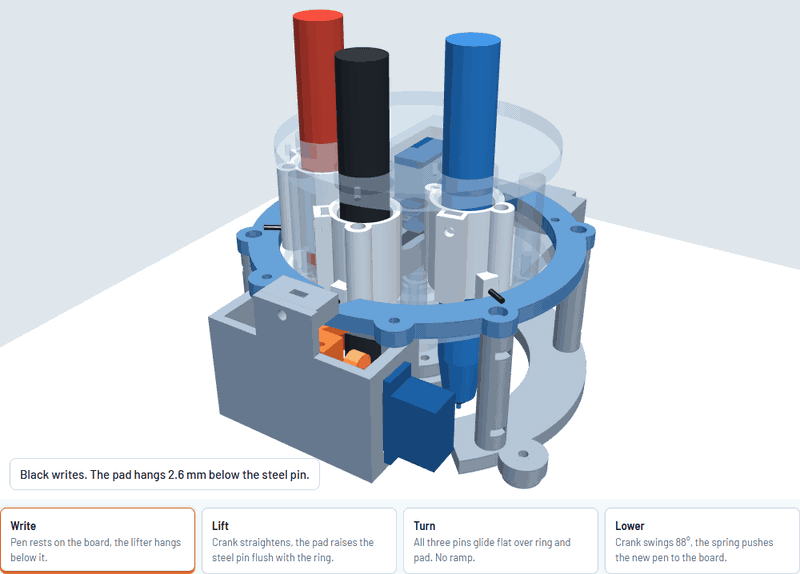
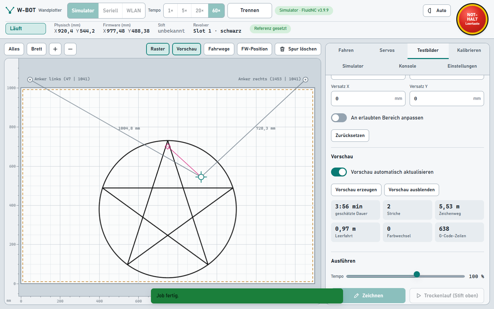
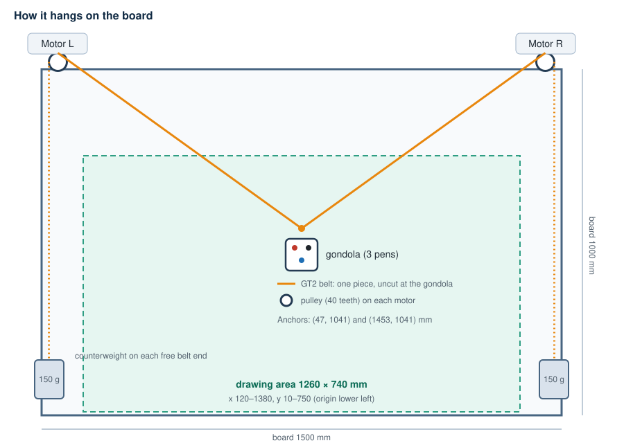

# W-BOT

**A whiteboard V-plotter that changes its own pen colour.** Two stepper motors pull a small gondola over a whiteboard with a single GT2 belt. The gondola carries a three-pen revolver and lifts only the active pen, so it draws in three colours without a human touching it.

> 🚧 **Early stage, work in progress.** The design and the software are evolving quickly; see [Status](#status).

<p align="center">
  
</p>

*Colour change: lift the active pen, turn the drum, lower the next pen. Real printed parts from the Fusion model.*

## Features

| | |
|---|---|
| 🎨 **3 colours, no ramp** | Steel pins glide flat over a park ring; a crank lifter raises one pen 5 mm |
| 🎯 **Accurate** | Software pre-distorts every point for belt wrap and gondola tilt (< 0.05 mm in the simulator) |
| 🖥️ **Web UI + simulator** | Jog, calibrate, preview, draw. Starts in a simulator, real hardware only on request |
| 📷 **Camera calibration** *(experimental)* | Board overlay, tape-measure and automatic calibration |
| 🤖 **AI drawing** | [MCP](https://modelcontextprotocol.io) server: preview and draw shapes, text and SVG safely |
| 📶 **Wi-Fi** | Telnet / WebSocket to the FluidNC board; fake board for testing |
| 🖨️ **Printable, open** | Fusion archive, STL and ready Bambu Studio project included |

<p align="center">
  <br>
  <sub>Web UI in simulator mode (interface text is currently German)</sub>
</p>

## Build one

<p align="center"><a href="v1.0/README.md"></a></p>

| 1 · Buy | 2 · Print | 3 · Assemble | 4 · Wire | 5 · Run |
|---|---|---|---|---|
| [Bill of materials](v1.0/docs/bom.md) | [Printing](v1.0/docs/printing.md) | [Assembly](v1.0/docs/assembly.md) | [Electronics](v1.0/docs/electronics.md) | [Software](docs/software.md) |

CAD files: [`v1.0/cad/`](v1.0/cad/README.md)

## Try the software (no hardware)

```powershell
python -m venv .venv
.venv\Scripts\python.exe -m pip install -e ".[mcp,dev]"
.venv\Scripts\python.exe -m wbot serve          # http://127.0.0.1:8000/
```

Linux/macOS: `.venv/bin/python`.

## Versions

| Version | Folder | Changes |
|---|---|---|
| **v1.0** | [`v1.0/`](v1.0) | First release: gondola V2 (park ring, crank lifter), motor mounts, counterweights, complete Bambu Studio project |

Each hardware revision gets its own folder; see the [CHANGELOG](CHANGELOG.md).

## Repository

| Path | |
|---|---|
| `v1.0/` | Hardware version 1.0: `cad/` and build guides |
| `wbot/`, `ui/`, `wbot_tests/` | Host software, web UI, tests |
| `config/wbot.yaml` | Machine configuration |
| `docs/` | Software guide |

`wbbot/`, `web/` and `tests/` are the previous software generation and are being phased out.

## Status

The software runs end to end against the simulator. Gondola V2 and the frame parts are designed and collision-checked; fit tests are printed and the full machine is being validated on real hardware, so parts, dimensions and docs will change. Ideas, issues and build reports are welcome.

**There are no end stops**; the drawing area is enforced by the software only. Read the safety table in the [software guide](docs/software.md) before you move a real machine.

## License

- **Software** (everything outside `v1.0/`): [GPL-3.0](LICENSE)
- **Hardware files and build guides** (`v1.0/`): [CC BY-NC-SA 4.0](v1.0/LICENSE)

Please **don't re-upload the models to model-sharing sites as your own work**; link back to this repository instead.
