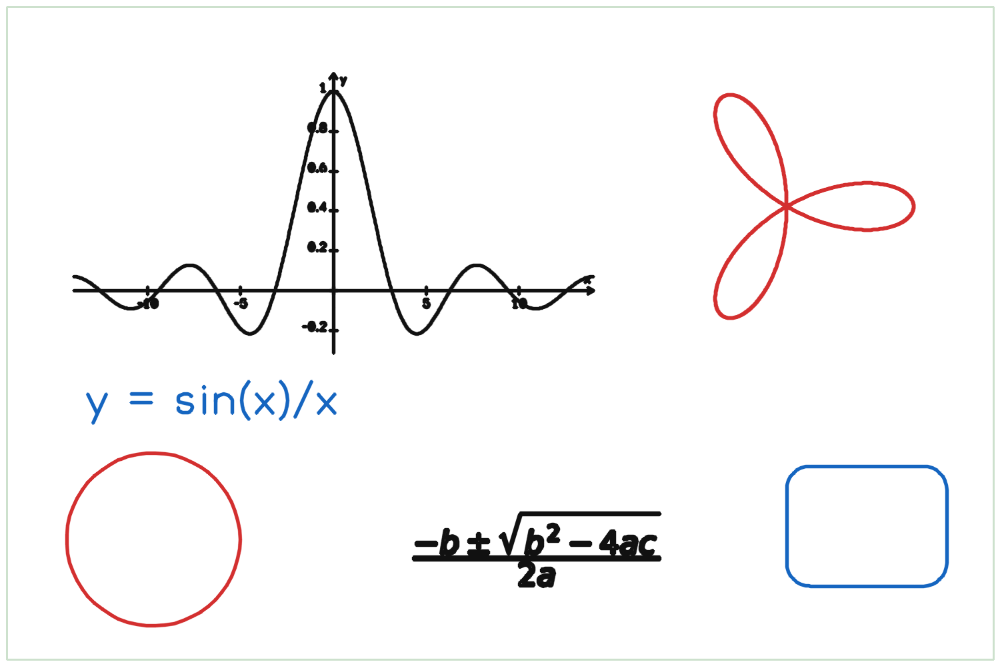

# Software guide

Python host (FastAPI) + web UI, no build step. Talks to **FluidNC v3.9.9** on the MKS DLC32 over USB or Wi-Fi.

<p align="center"></p>

## Run

```powershell
.venv\Scripts\python.exe -m wbot serve                                # simulator, http://127.0.0.1:8000/
.venv\Scripts\python.exe -m wbot serve --connect serial --port COM3   # real board (on purpose only)
.venv\Scripts\python.exe -m wbot serve --connect wifi --board-host wbot.local
.venv\Scripts\python.exe -m wbot firmware-config > config.yaml        # FluidNC config
.venv\Scripts\python.exe -m pytest                                    # tests, no hardware needed
```

The UI starts in the **simulator**; real hardware only opens on request. (UI text is currently German.)

## Why it is accurate

FluidNC assumes belt length = distance from pulley centre to pen. The real belt leaves the pulley **tangentially and wraps around it**, so the error is 10 mm and more. `wbot/kinematics.py` **pre-distorts** every point so the firmware's naive move equals the true one; `wbot/gondola.py` adds the tilt of the hanging gondola. Simulated error < 0.05 mm (12–17 mm without).

| | |
|---|---|
| Drawing area | x 120–1380, y 10–750 mm (`board.margin_*`) |
| Reference | hang the gondola at the start corner when powering on, then press "gondola is here now" |
| Steps | 40 steps/mm (40-tooth pulley, 1/16 microstepping) |

## Safety

| Rule | |
|---|---|
| Every G-code line is checked | range, servo limits, no relative XY moves (`wbot/safety.py`) |
| Order | pen up → wait → turn revolver → wait → pen down |
| Emergency stop | space bar or red button; lost connection = stop |
| No end stops | the area is enforced by the host only |

## Wi-Fi

```powershell
.venv\Scripts\python.exe -m wbot wifi-commands --ssid MyNetwork --hostname wbot   # prints FluidNC setup commands, sends nothing
.venv\Scripts\python.exe -m wbot probe --board-host wbot.local                    # read-only check
.venv\Scripts\python.exe -m wbot sim-server --tcp-port 2323 --speed 20            # fake board for testing
```

No password is stored in the project. FluidNC Telnet/WebSocket have **no login**: trusted networks only.

## Camera (experimental)

Point a webcam at the board for an overlay in the UI, a tape-measure calibration, gondola tracking and automatic calibration from drawn crosses. A simulated camera lets you try everything without hardware (`wbot_tests/test_camera.py`). Not yet verified with a real webcam.

## AI control (MCP)

An MCP server lets an AI assistant preview and draw shapes, text and SVG through the same safety layer as the UI.

| | |
|---|---|
| Embedded | `wbot serve`, then add `http://127.0.0.1:8000/mcp` as a streamable-HTTP MCP server |
| Standalone | `python -m wbot mcp --api http://127.0.0.1:8000` (stdio), `PYTHONPATH` = repo |
| Tools | `get_status`, `preview_drawing`, `draw_pattern`, `draw_shape(s)`, `draw_text`, `draw_svg`, `camera_snapshot`, `pause/resume/cancel_job`, `emergency_stop`, … |
| **Cannot** | raw G-code, connect, set reference, change config, flash firmware |

`config/wbot.yaml` → `mcp`: `allow_motion: false` is a kill switch (preview only), `require_confirm_real_hardware: true` asks first. Set `WBOT_MCP_TOKEN` before exposing `/mcp` on a network.

## Layout

| Path | |
|---|---|
| `wbot/kinematics.py`, `gondola.py` | belt model, pre-distortion |
| `wbot/planner.py`, `drawing.py`, `patterns.py`, `svgimport.py` | drawing → G-code |
| `wbot/fluidnc/` | protocol, serial/Wi-Fi links, streaming client |
| `wbot/sim/` | FluidNC emulator and physics |
| `wbot/camera/`, `camera_api.py` | camera support |
| `wbot/mcp_*.py` | MCP server |
| `wbot/api/`, `ui/` | REST/WebSocket API, web UI |
