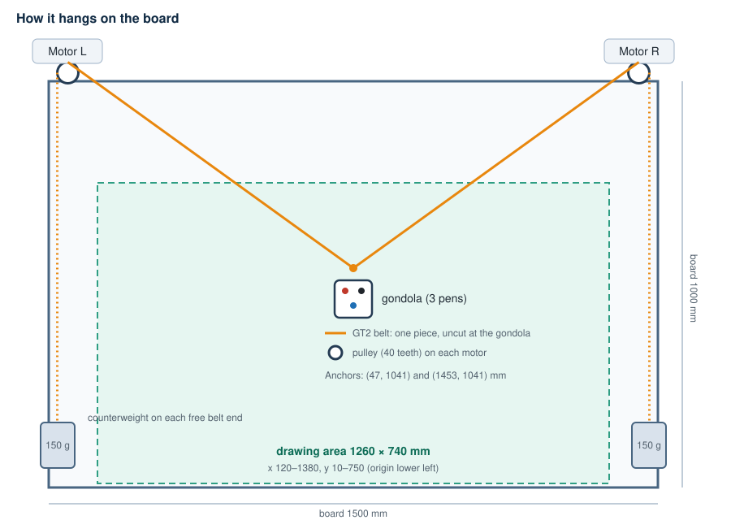

# W-BOT hardware v1.0

| Step | | Guide |
|---|---|---|
| 1 | **Buy** the parts | [Bill of materials](docs/bom.md) |
| 2 | **Print** the parts (≈ 10.5 h sliced) | [Printing](docs/printing.md) |
| 3 | **Assemble** the gondola | [Assembly](docs/assembly.md) |
| 4 | **Wire** and flash the board | [Electronics](docs/electronics.md) |
| 5 | **Run** the software | [Software guide](../docs/software.md) |

## Files

| Folder | Content |
|---|---|
| [`cad/`](cad/README.md) | Fusion archive, print-ready STL, Bambu Studio projects, presets |
| [`docs/`](docs) | Build guides and images for this version |

Hardware files and docs in this folder are licensed **CC BY-NC-SA 4.0** (see [`LICENSE`](LICENSE)). The software in the repository root is GPL-3.0.
