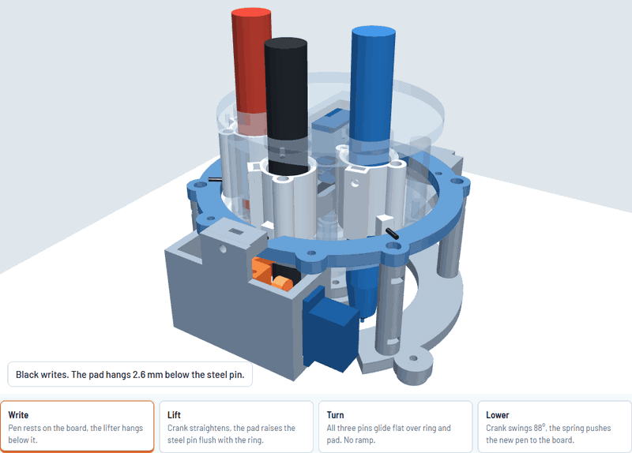
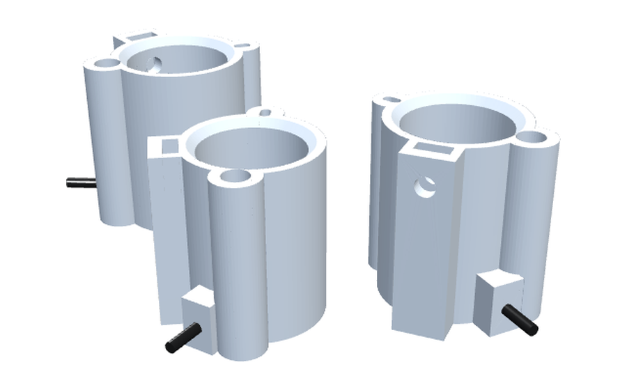
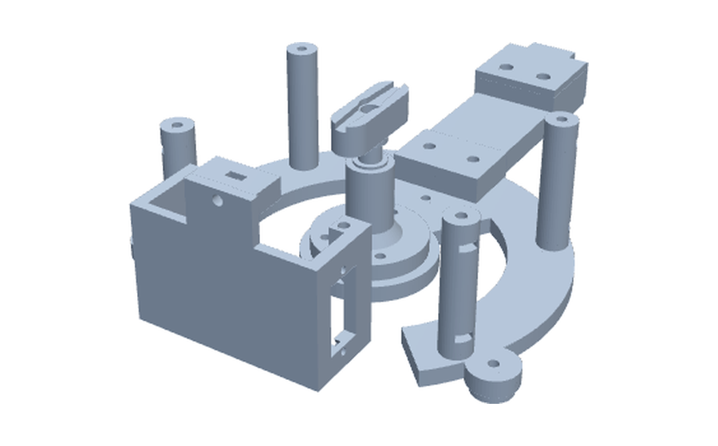
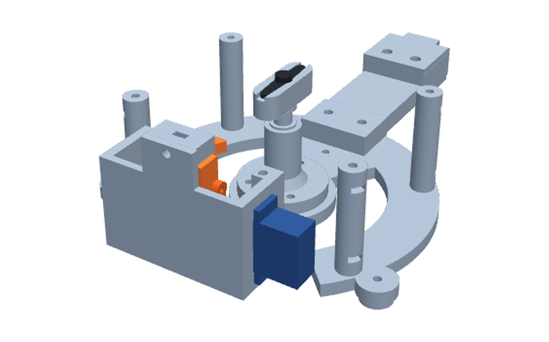
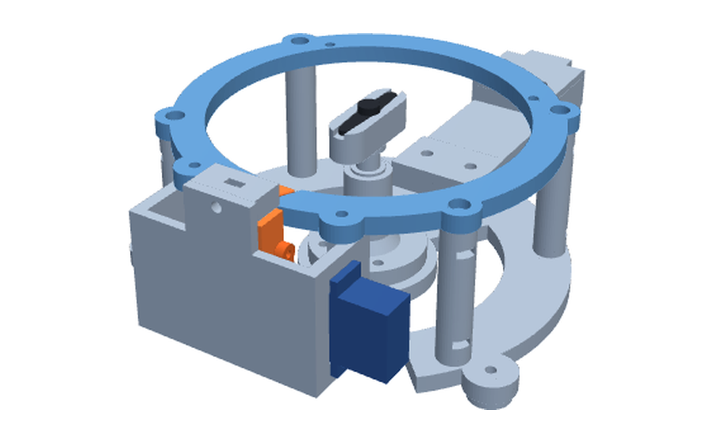
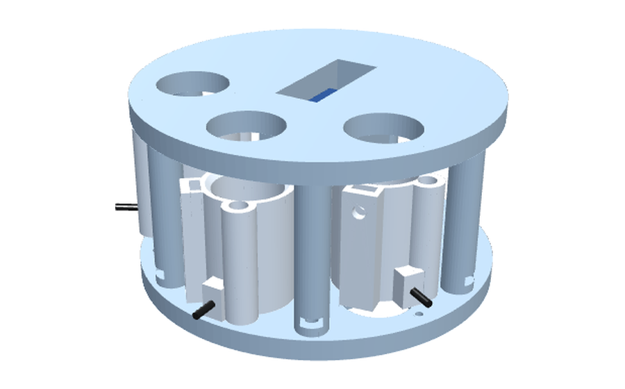
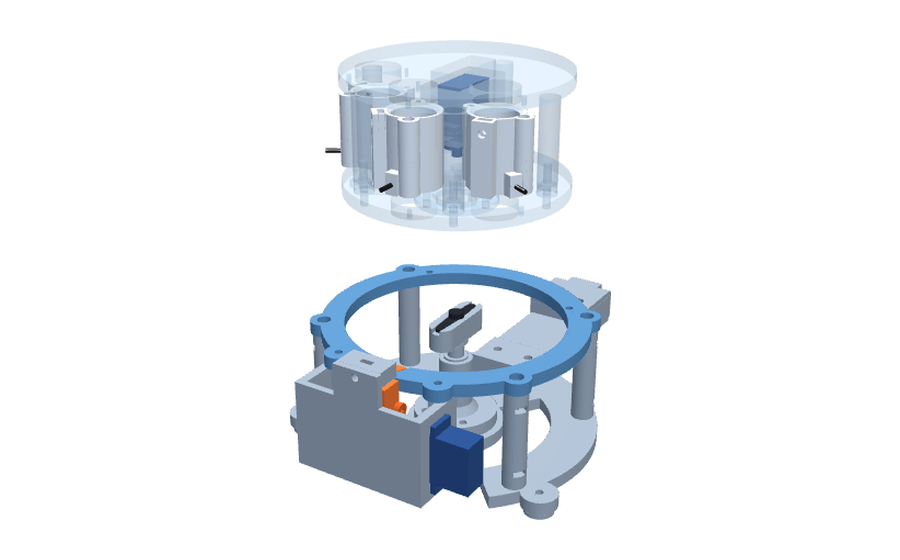
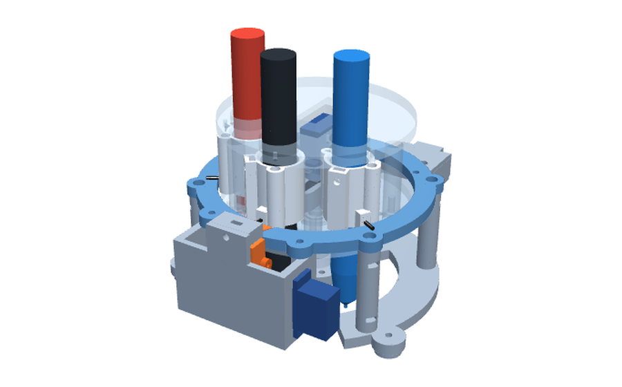
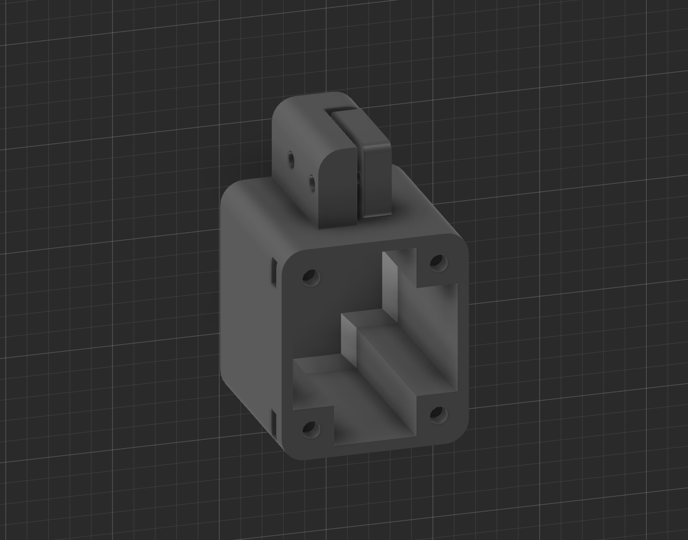
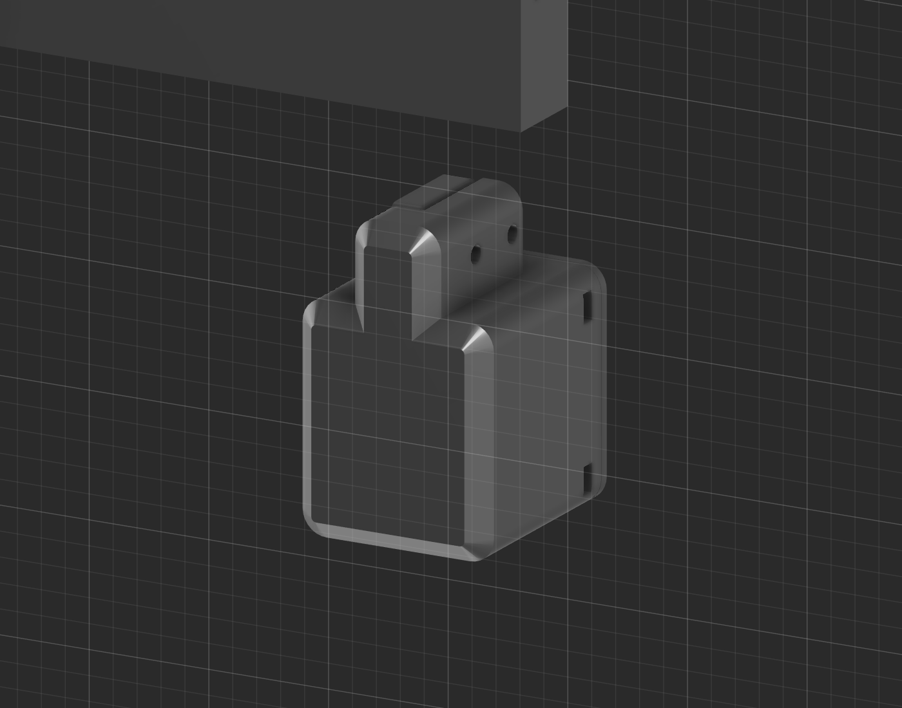

# Assembly (v1.0)

Hand-tight screws only (nuts sit in plastic). Build four sub-assemblies, then join them. Hardware counts: [BOM](bom.md).

## A · Pins

- Press a 14 mm pin into each **pen carriage** nose (7 mm out)
- Press the second 14 mm pin into the **lifter carriage** (4 mm out)
- Press the 8 mm pin into the **crank** (3 mm out, smooth side)
- Try the double-arm horn in all three **horn anchors**; keep the snuggest
- A drop of glue fixes a loose pin

 

## B · Base

1. Nuts in the base plate, **bearing block** on, 3 × M3×12
2. **Posts**: nuts top and bottom, 4 × M3×12 from below
3. **Glide feet**: M3×8
4. **Belt arm**: 2 × M4×16. Lay the belt (uncut) around the round web, teeth out, a **belt clamp** each side, cover on with 2 × M5×20, then tighten the two side M3

 

## C · Lifter

1. **Servo B** in its wall, 2 × M2×8
2. **Lifter carriage** between the blocks, two 49 mm rods through, **head piece** on top
3. Check: the carriage drops by itself
4. Servo B to "pen up", rod on both pins, press the single-arm horn on so the **rod is straight**

 

## D · Park ring

1. Ring **smooth side up** on the posts, 4 × M3×12
2. Lifter bracket under the ring, centre the pad in the angled gap (≈ 0.3 mm air each side)
3. Two M3×12 + nut at the top holes = end stops (≈ 70°)

 

## E · Drum cassette

1. Bearing and bearing ring in the **lower drum**
2. Rods into the **upper drum**: 2 mm outer, 1.5 mm inner; spring on each 2 mm rod
3. Slide the **carriages** on (spring toward the cover disc, driver pin out); horn anchor loose in the middle
4. Lower drum on, 5 × M3×12
5. Check: each carriage moves 6.5 mm and springs back

 

## F · Insert the cassette

1. Lifter **up** (pad flush with ring), lower the cassette on; pins rest on ring and pad
2. M3×20 through the servo box into the horn anchor
3. Servo A to **A90**, double-arm horn on, servo into the box, 2 × M2×8
4. Check: drum turns smoothly ±70° to the stops

 

## G · Pens

1. Gondola flat on its feet, lifter up
2. Pen insert if the pen is thinner than 18 mm
3. Put the **5 mm gauge** under the bore, push the pen down onto it, lightly tighten the clamp screw

 

## Set the angles

| `config/wbot.yaml` | Value |
|---|---|
| `servos.pen.up_deg` / `down_deg` | **44** / **−44** |
| `servos.revolver.min_deg` / `max_deg` | **−66** / **66** |
| `servos.revolver.slots_deg` | −60, 0, 60 |

Servo turns the wrong way? Swap pen up/down. The revolver may only turn with the pen **up**; the software enforces it.

## If it sticks

| Symptom | Fix |
|---|---|
| Pad not flush with ring | longer rod (14.15 / 14.30) if low, shorter (13.85 / 13.70) if high; max 0.15 mm step |
| Carriage jams on its rod | ream the bore |
| Pen does not follow the pad down | ream the bore, spring 0.3 × 4 × 25 |
| Colours miss the same spot | take the next-tighter horn anchor |
| Belt slips | re-tighten the two M3 on the belt clamps |
| Gondola lifts off its feet | spring too strong or pen too low |

## Frame and counterweights

  
  

Motors at the top corners (see [layout](img/system-overview.svg)), pulley on each shaft, belt over the pulley (never on a spool), **counterweight (≈ 150 g) on each free end. Hang the weights before the motors get power.**
