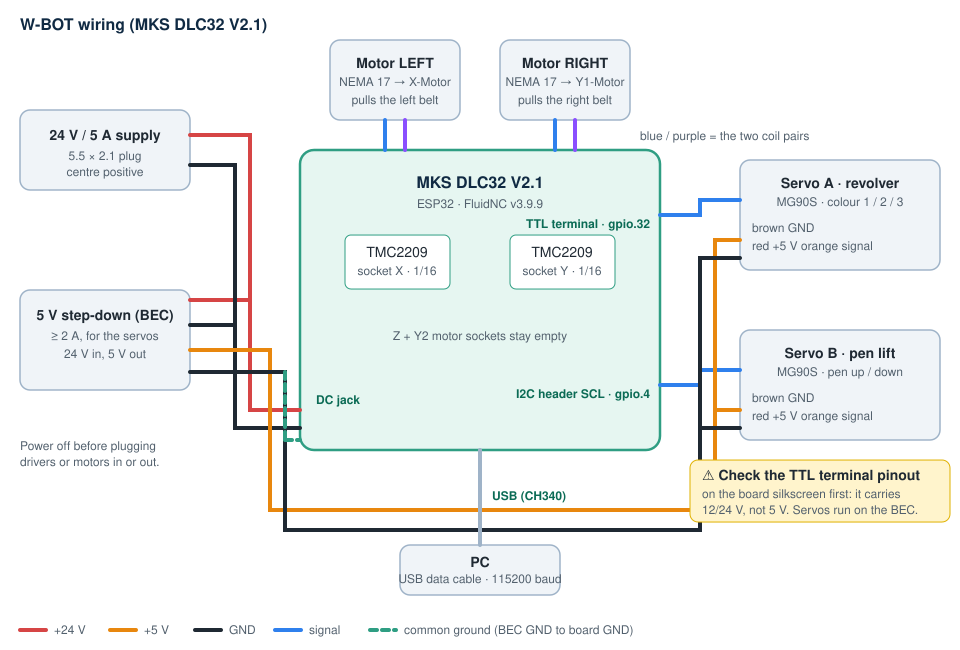

# Electronics (v1.0)

> ⚠ Power off before plugging drivers or motors in or out. Hang the counterweights **before** the motors get power. There are no end stops.

## Settings at a glance

| What | Value |
|---|---|
| Left motor → | `X-Motor` socket (left belt) |
| Right motor → | `Y1-Motor` socket (right belt) |
| TMC2209 microstepping | **1/16** (MS1 + MS2 high) |
| TMC2209 Vref | ≈ 0.85 V, measured with 24 V on |
| Servo A (revolver) | TTL terminal, `gpio.32` |
| Servo B (pen) | I2C header SCL, `gpio.4` |
| Motor turns wrong way | `drive.invert_left/right` in `config/wbot.yaml` |

Servos run on the **5 V BEC**; connect its GND to the board GND.

## Flash FluidNC

The board ships with Grbl; it needs [FluidNC](https://github.com/bdring/FluidNC) for wall-plotter kinematics.

1. **Back up** the factory firmware first (keep it private, it can contain your Wi-Fi password)
2. Bridge `SDA` to `GND` on the I2C header (that is `GPIO0` = download mode), power on 24 V
3. Flash with `esptool` at **460800** baud (921600 drops out)
4. Remove the bridge
5. Generate and upload the config: `python -m wbot firmware-config > config.yaml`, then XMODEM
6. Read the boot log: `Kinematic system: WallPlotter`, `Axis count 4`, no `[MSG:ERR`

Details of the flash command are in the [FluidNC docs](https://github.com/bdring/FluidNC) and the [MKS DLC32 repository](https://github.com/makerbase-mks/MKS-DLC32).

## Bring-up

| # | Test | Pass when |
|---:|---|---|
| 1 | Boot log (above) | no errors |
| 2 | Servos, **no belts**: pen up/down, colour 1/2/3 | moves, no stalling |
| 3 | Motors, **no belts**: short moves | direction correct |
| 4 | Belts and counterweights on, gondola at the start corner | hangs steady |
| 5 | Software: connect, set reference, calibration grid dry | grid matches a tape measure |

Verify microstepping: belts off, send `$J=G91 X80 F500` with kinematics disabled; the pulley must turn **exactly once**.

Wi-Fi: FluidNC Telnet/WebSocket have **no login**; use a trusted network only.
